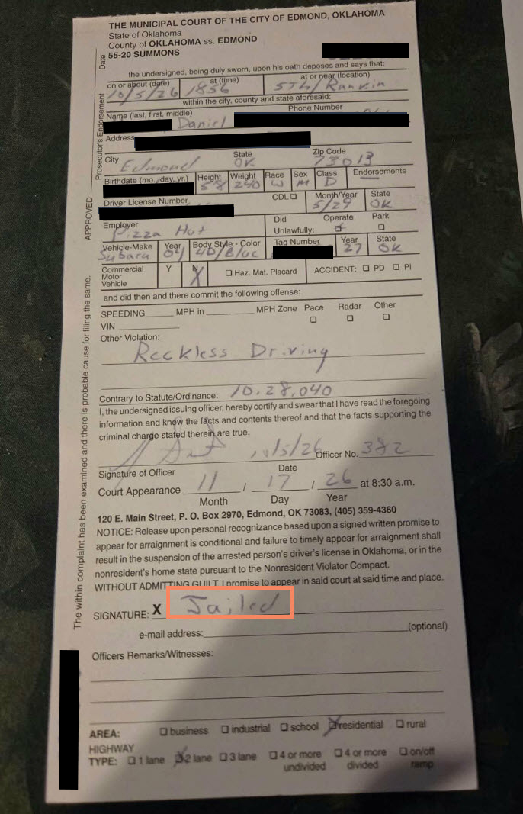

# Edmond Police Department: Evidence collection

**Collection:** `edmond-police`  
**Investigation:** [Edmond Police Department](../../../oklahoma/investigations/edmond-police.md)  
**Incident date:** 2026-10-05

## EPD-001: Municipal traffic citation marked "Jailed"

The citation identifies reckless driving under Edmond Municipal Ordinance 10.28.040 as the alleged offense. The defendant's signature line contains the handwritten entry "Jailed", immediately below the printed promise-to-appear language and notice concerning release on personal recognizance.

[Open the redacted citation photograph](epd-001-public.jpg)

**Source:** Photograph of the municipal citation supplied by the affected motorist's representative. The Coalition's publication copy is redacted and includes an orange editorial outline highlighting the signature field. Embedded metadata has been removed.

**What this establishes:** The wording visible on the citation, including the charge, ordinance number and signature-line entry.

**What this does not establish:** Whether the motorist was offered a chance to sign, who physically wrote the entry based on the photograph alone, whether the statutory release conditions were met, or whether the arrest or impoundment was lawful.

Direct personal identifiers have been redacted. Remaining contextual details may permit identification through other records.

See the [evidence integrity manifest](manifest.json) for the publication-copy fingerprint. The supplied photograph was already redacted; its fingerprint is not a hash of the unredacted original citation.
